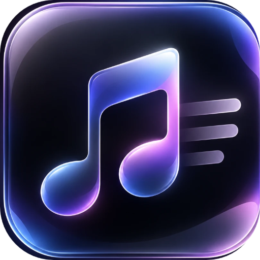
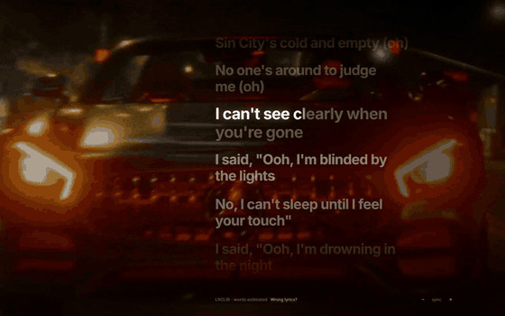
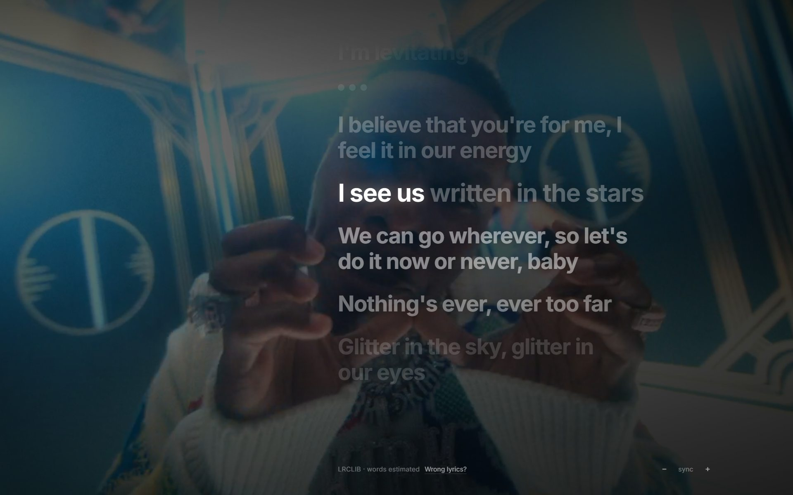
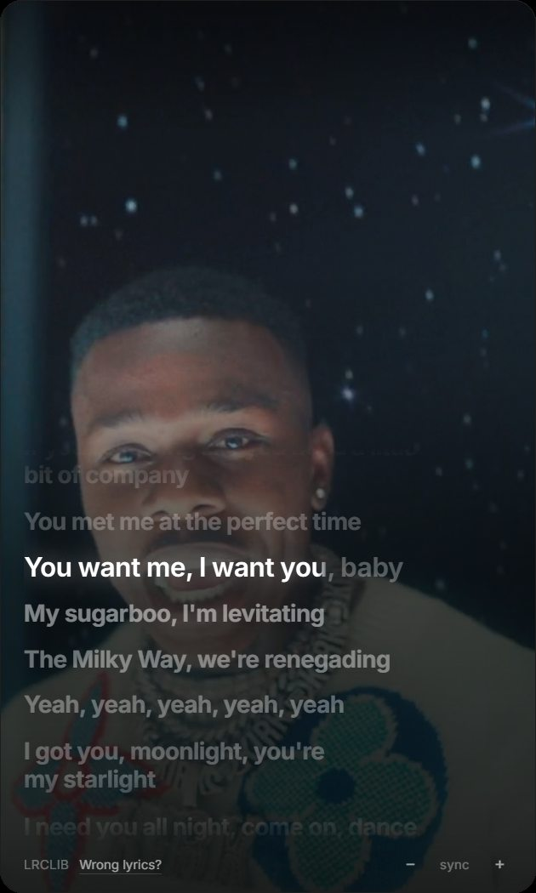
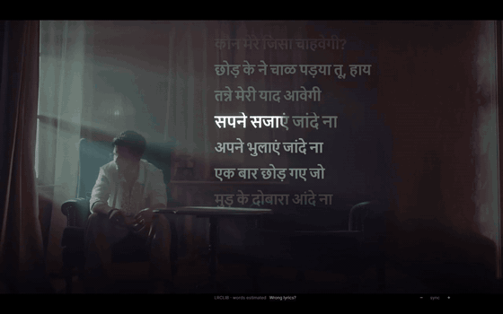

<p align="center">
  
</p>

<h1 align="center">Lyra</h1>
<p align="center"><b>Lyrics that move with the music.</b><br />
Word-by-word synced lyrics over the music video of what you play. For Windows and Android. Free, open source, no account.</p>

<p align="center">
  <a href="https://github.com/DhruvHarani1/lyra/releases/latest"></a>
  <a href="https://github.com/DhruvHarani1/lyra/releases?q=android"></a>
  <a href="https://lyra-website-rho.vercel.app"></a>
</p>
<p align="center">
  
  
  <a href="https://github.com/DhruvHarani1/lyra/releases"></a>
  <a href="https://github.com/DhruvHarani1/lyra/stargazers"></a>
</p>

<p align="center">
  
</p>

## Why Lyra

- **Every word, on time.** Words fill in as they are sung, including Hindi, Punjabi and other scripts.
- **Over the music video.** The official video (or your own clip) plays softly behind the lyrics, and the whole UI takes on the cover's colours.
- **A floating widget on Windows, a screen saver on Android.** Fullscreen lyrics, a lock-screen card, and an ambient mode with a clock for the desk.
- **Export a lyric video.** One button makes a finished MP4 of the chorus or the whole song, from what is playing or from your own audio file (faster than real time) (Reels 9:16, 4:5, square or 16:9 up to 1440p) with the music, word-by-word lyrics and a small Lyra badge. The official YouTube video can play behind the lyrics. Windows.
- **Share a lyric card.** Tap the share icon on any line to make a story-sized image with the song, the cover colours and your lines.
- **Listen together.** Share a room link and friends see your synced lyrics live in any browser. Friends with Lyra can join and keep their own player in sync with yours.
- **TV mode and Jam nearby.** Put big lyrics on a TV or phone over your Wi-Fi, and optionally stream the PC's sound there too.
- **Private.** No account, no ads, no analytics. Everything runs on your device. See [PRIVACY.md](PRIVACY.md).

<p align="center">
  
  
</p>
<p align="center"></p>

## Install

| Platform | How |
|---|---|
| **Windows 10/11** | Download `Lyra-Setup-x.y.z.exe` from the [latest release](https://github.com/DhruvHarani1/lyra/releases/latest), or `winget install DhruvHarani1.Lyra` once it is listed. Windows may show a SmartScreen notice because the app is not code-signed yet: choose *More info → Run anyway*. |
| **Android 8+** | Download `Lyra-Android-x.y.z.apk` from the [Android releases](https://github.com/DhruvHarani1/lyra/releases?q=android) and open it. Grant *Notification access* so Lyra can see what is playing. F-Droid / IzzyOnDroid listings are being prepared. |

Lyra reads the **Spotify desktop app** on Windows (through Windows media controls) and any media app on Android. Lyrics come from the free [LRCLIB](https://lrclib.net) database.

## Help it grow

Star the repo, tell a friend, or open an issue. Good first issues are labelled. Translations, new lyric sources and bug reports are all welcome: see [CONTRIBUTING.md](CONTRIBUTING.md).

---

## Build and run from source
Requirements: Node 20+, the **Spotify desktop app** (not the web player).

```bash
npm install
node node_modules/electron/install.js   # only if you get "Electron uninstall"
npm run dev        # development
npm test           # LRC parser tests
npm run typecheck
npm run build && npm start   # production build preview
npm run dist       # Windows NSIS installer in ./release
npm run dist:local # same, but works around antivirus EPERM rename failures
```
Play a song in Spotify — the widget shows it. Click the widget to expand; fullscreen button (or `F`) for immersive lyrics. No Spotify handy? *Settings → Music source → Demo*.

## Music sources
| Source | Needs | Gives | Missing |
|---|---|---|---|
| **Windows (default)** | Spotify desktop app | title, artist, album, artwork, position, play/pause/next/previous/seek, **system volume**, release year (MusicBrainz), Lyra-local favorites ♥ | queue, shuffle/repeat (buttons hidden), syncing likes to Spotify |
| Spotify API (optional) | your own Spotify Developer app (Client ID) | everything above + volume, queue, likes, devices | **Premium** for any control; Dev Mode needs a Premium app owner and your account under *User Management* |
| Demo | nothing | simulated playback with sample lyrics | — |

How the default works: a tiny native helper (`resources/lyra-media.exe`, ~14 KB, C#) subscribes to the Windows System Media Transport Controls events and streams JSON to the app (`src/main/smtc`, `native/lyra-media`). It is event-driven (≈0% CPU idle) and only follows a session whose app id contains "Spotify". Rebuild it with `npm run build:helper` (needs the Windows SDK; the built exe is committed). If the exe is missing the app falls back to a PowerShell bridge. Volume (opt-in: *Settings → System → Control system volume*) is the Windows master volume via Core Audio. Release year is looked up once per song on MusicBrainz and cached. Favorites are stored locally in `favorites.json`.

### Optional: Spotify API setup (on hold — implemented but not yet tested against a real account)
1. https://developer.spotify.com/dashboard → *Create app* (Web API).
2. Redirect URI, exactly: `http://127.0.0.1:53682/callback`
3. Copy the **Client ID** (PKCE — no secret). Paste it in *Settings → Music source → Spotify API*, or set `SPOTIFY_CLIENT_ID` in `.env` (see `.env.example`).
4. Add your account under *User Management*.

Tokens are encrypted with Windows DPAPI (`safeStorage`); passwords are never seen. The API source polls (3 s playing / 6 s paused / 5–15 s idle, honours `Retry-After`).

## Lyrics
**LRCLIB** (free, keyless, timestamped LRC; descriptive User-Agent; no scraping). Line-synced; word-level timing is supported by the engine (enhanced LRC) but LRCLIB rarely has it — the demo shows it. Results are cached on disk. Plain-only lyrics are shown unsynced, with a notice. Use the `−`/`+` footer (or `[` `]`) to nudge sync. Providers are pluggable: implement `LyricsProvider` in `src/main/lyrics/provider.ts`, add it to the chain in `service.ts`.

## Animated backgrounds (cinematic mode)
Spotify's own looping "Canvas" videos have no public API, so Lyra offers three legitimate sources, all optional (Settings → Background, one on/off switch):
1. **Living artwork** (default) — the cover art drifts and breathes with the palette. No network, no key.
2. **Your own file** — a GIF, image, MP4 or WebM, for every song or just one song. Copied into Lyra's folder.
3. **Official video** — paste a free YouTube Data API v3 key and the official music video plays muted behind the lyrics (cached per song to save quota; pick another video if it guessed wrong).

Auto order: your per-song file → your global file → a free 30 s Apple music-video preview when one exists → YouTube (only if you added a key) → living artwork. Videos pause while the window is hidden or reduce-motion is on.

## Android
Lyra also runs on Android (8.0+). It is the same UI and the same shared core (`src/core`), inside a small Kotlin shell (`android/`).

- **Install:** F-Droid packaging is prepared (see [docs/FDROID.md](docs/FDROID.md)); until it is listed, download `Lyra-Android-<version>.apk` from the [Releases](../../releases) page (look for tags named `android-v…`) and open it. Android will ask you to allow installs from your browser or file manager the first time.
- **If Google Play Protect says "App blocked to protect your device":** Google blocks apps that ask for *Notification access* (Lyra needs it to see what is playing) when they are installed straight from a browser or file manager, and that dialog has no "install anyway" button. Lyra is open source and has no tracking; to install it anyway use one of these:
  1. **Turn Play Protect scanning off for a minute:** Play Store → your profile picture → *Play Protect* → the gear → switch off *Scan apps with Play Protect*, install Lyra, then switch it back on.
  2. **Install from a computer:** with USB or wireless debugging on, run `adb install Lyra-Android-<version>.apk`.
  3. **Use an app store instead of the browser:** [Obtainium](https://github.com/ImranR98/Obtainium) can install and update Lyra straight from the GitHub releases; F-Droid / IzzyOnDroid listings are being prepared.
- **What it does:** reads what any music app (Spotify, YouTube Music…) is playing from Android's media sessions, shows synced lyrics with word-by-word highlighting, and plays the Apple / YouTube / your own video behind them. The title and controls fade away after a few seconds and the lyrics grow into the space; touch brings them back.
- **One permission to grant:** *Notification access*. Lyra only reads the now-playing card (title, artist, position). It never reads your notifications.
- **Optional (Settings → Phone):** keep the screen on while a song plays, keep Lyra running in the background, a floating lyrics widget over other apps ("Display over other apps"), your own video/GIF per song or for all songs, and a YouTube API key (stored encrypted in the Android Keystore).
- **Build it yourself:** install JDK 17 and the Android SDK (platform 36), then:
  ```bash
  npm ci
  npm run build:android-ui         # builds the web UI into android/app/src/main/assets/ui
  cd android && ./gradlew assembleDebug
  ```
  Release APKs are built and signed by the **Android** GitHub workflow when a tag like `android-v0.1.0` is pushed (secrets: `ANDROID_KEYSTORE_BASE64`, `ANDROID_KEYSTORE_PASSWORD`, `ANDROID_KEY_ALIAS`, `ANDROID_KEY_PASSWORD`). Without those secrets (a fork) it signs with the debug key instead.
- **Architecture:** `src/android-web` implements `window.lyra` for the phone (the same interface the Windows app uses); `android/app/src/main/java/dev/lyra/android` has the media-session reader, the origin-restricted bridge (`Rpc.kt`), the floating widget and the Keystore storage. Contributions welcome.

## Notes & limits
- Windows can't blur the desktop behind a transparent window, so "glass" = translucent panel + blurred artwork layer, not true acrylic.
- Always-on-top uses the highest topmost level and is re-asserted on blur and every 2.5 s.
- Spotify changed Development-Mode API rules in 2025–26; API features degrade (disabled buttons, explanations) instead of failing.

## Layout
```
src/shared     types, IPC contract, LRC parser (+tests), shortcut list
src/main       window (modes, tween, drag, monitors) · tray · shortcuts · settings
               smtc/ (Windows media bridge) · spotify/ (PKCE API) · lyrics/ · demo/ · artwork · ipc
src/preload    typed contextBridge API
src/renderer   store/ · hooks/ · components/ · styles/
```

## Keys
Global: Ctrl+Alt+Space play/pause · Ctrl+Alt+←/→ prev/next · Ctrl+Alt+L expand · Ctrl+Alt+F fullscreen · Ctrl+Alt+H show/hide.
In-app: Space, ←/→ seek, Shift+←/→ tracks, ↑/↓ volume (API source), F, Esc, D (distraction-free), `[` `]` lyric offset.

## Roadmap
Free replacements for the account-free gaps (see issues), configurable shortcuts, installer icon + autostart polish, history dashboard, audio-reactive visualiser, lyric translation, moments export.

## Legal & privacy
MIT licensed ([LICENSE](LICENSE)). See [PRIVACY.md](PRIVACY.md) for exactly what leaves your PC and [THIRD_PARTY.md](THIRD_PARTY.md) for credits. Lyra is not affiliated with Spotify; Spotify is a trademark of Spotify AB.
